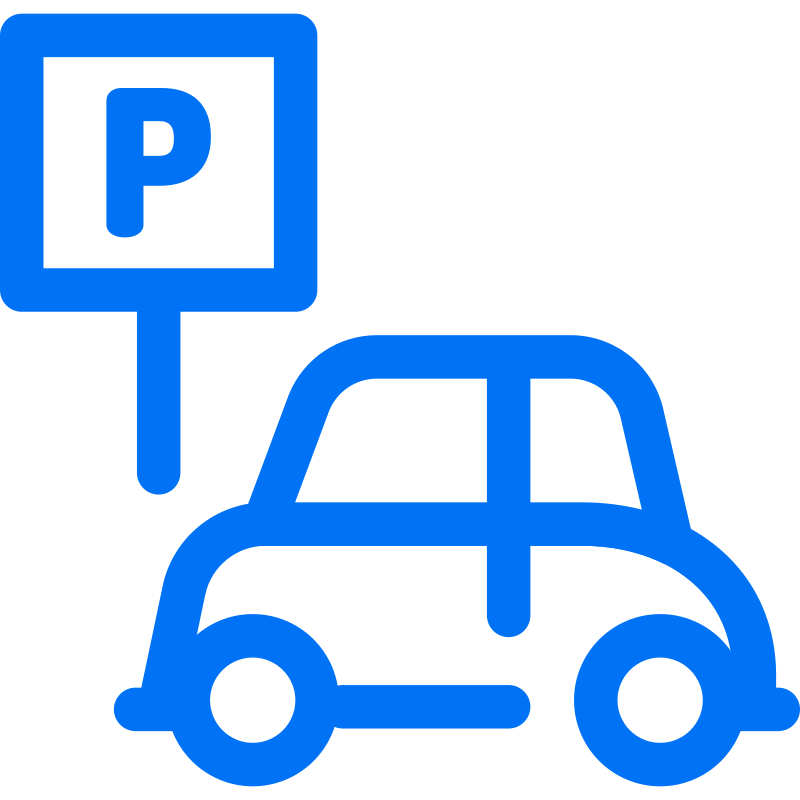

&nbsp; &nbsp;&nbsp;&nbsp;&nbsp;&nbsp;&nbsp;&nbsp;&nbsp;&nbsp;&nbsp;&nbsp;&nbsp;&nbsp;&nbsp;&nbsp;&nbsp;&nbsp;&nbsp;&nbsp;&nbsp; 

# vehicle-parking-app-v1 
 
#### It is a multi-user app (one requires an administrator and other users) that manages different parking lots, parking spots and parked vehicles. This parking app is for 4-wheeler parking only.

### Frameworks used 

<li>Flask for application back-end
<li>Jinja2 templating, HTML, CSS and Bootstraps for application front-end
<li>SQLalchemy - for database ORM
<li>Flask-SQLalchemy – Flask extension for simplifying SQLalchemy Operations
<li>SQLite for database

### How to run the Project 

<li>Make sure You have Python installed on your Machine.  
<li>Install all the required Python Modules From the requirement.txt file. 
&nbsp;&nbsp;&nbsp;&nbsp;&nbsp;For that oepn the Terminal in root directory of the Project.  
&nbsp;&nbsp;&nbsp;&nbsp;&nbsp;Then Run the command - <pre>pip install -r requirement.txt</pre> 
<li>With your Terminal in the root directory. 
&nbsp;&nbsp;&nbsp;&nbsp;&nbsp;Run - <pre>python app.py</pre> 
<li>Now Open Your Browser And Go to - <a href="http://127.0.0.1">http://127.0.0.1</a>  

